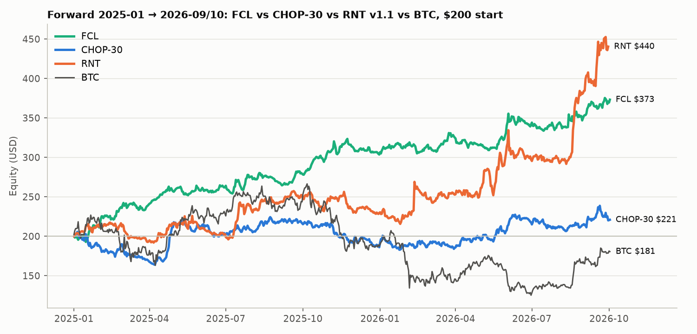
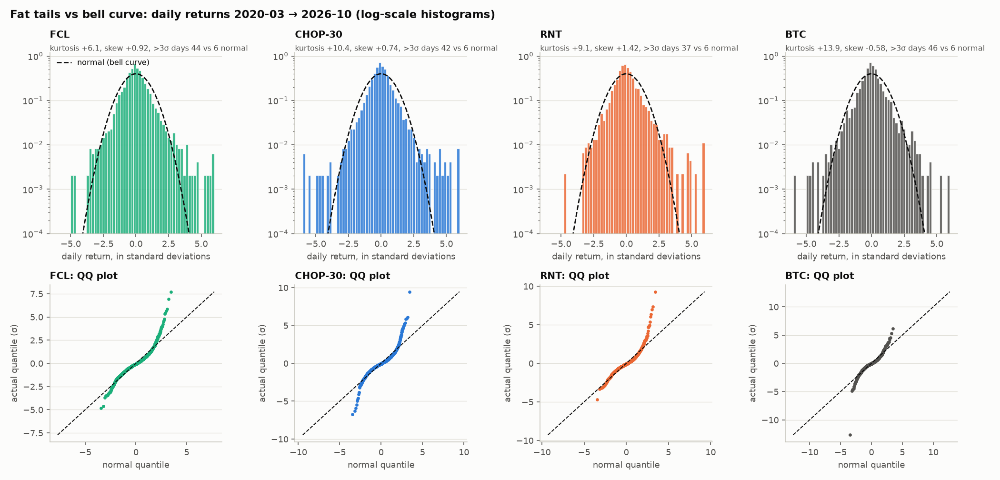
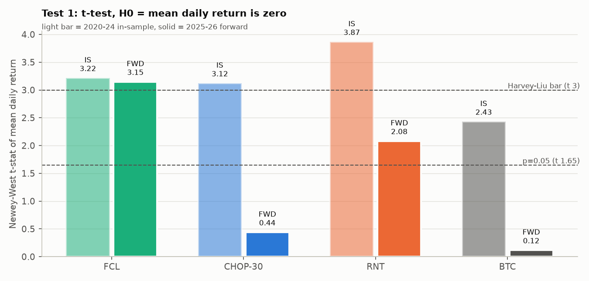
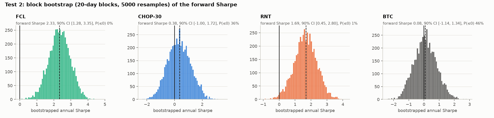
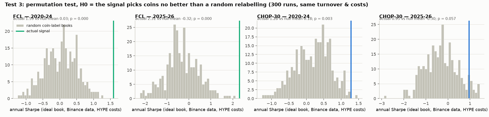
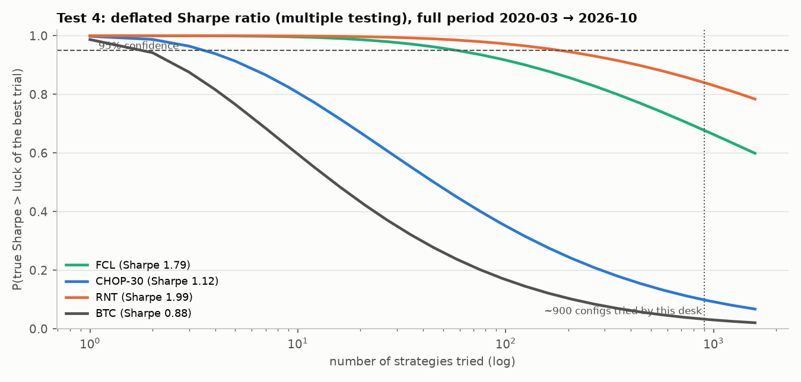

# Alpha Hunt (lanjutan): perbandingan dengan RNT, fat tail vs bell curve, dan 4 uji hipotesis

Lanjutan dari [Alpha Hunt CHOP-30 20261024.md](Alpha%20Hunt%20CHOP-30%2020261024.md). Yang dibandingkan ada 4 model:

| Model | Isi |
|---|---|
| **FCL** | Funding-crowding L/S |
| **CHOP-30** | Strategi utama, hanya pakai candle HYPE |
| **RNT v1.1** | Bot paper Anda |
| **BTC** | Buy & hold, sebagai benchmark |

Semua akun mulai $200 dan sudah dipotong fee + funding. IS = 2020–2024; forward = 2025-01 → 2026-09/10.

Sumber data per model:
- FCL dan CHOP-30: replay akun $200. IS pakai data Binance; forward pakai data HYPE.
- RNT: file harian resmi `Crypto-RS-Neutral & Trend/research/audit_response/v11_is_daily.csv` dan `v11_oos_daily.csv`. IS RNT mulai 2020-07.

> [!NOTE]
> Menurut README RNT sendiri, OOS RNT v1.1 **tidak lagi murni out-of-sample** karena v1.1 dibuat setelah v1.0 dilihat di OOS. Forward FCL dan CHOP-30 murni: spec dibekukan dulu, lalu forward dijalankan sekali.

Kode: [alpha_20261024/stats/analysis.py](alpha_20261024/stats/analysis.py) dan [perm_fair.py](alpha_20261024/stats/perm_fair.py). Angka mentah: `stats/analysis_results.json`.

---

## 1. Perbandingan dengan RNT

### Ringkasan

| | FCL | CHOP-30 | RNT v1.1 | BTC |
|---|---|---|---|---|
| **IS $200 →** | $868 | $1.094 | **$3.360** | $2.193 |
| IS CAGR / Sharpe | 35% / 1,64 | 42% / 1,32 | **88% / 2,10** | 64% / 1,09 |
| IS MaxDD | −27% | −29% | −26% | −77% |
| **Forward $200 →** | $373 | $221 | **$440** | $181 |
| Forward CAGR / Sharpe | 43% / **2,33** | 6% / 0,38 | 57% / 1,69 | −6% / 0,08 |
| Forward MaxDD | **−6,6%** | −20% | −16% | −53% |
| Forward vol tahunan | **16%** | 21% | 29% | 44% |
| Forward bulan positif | **77%** | 55% | 62% | 55% |
| Bulan terburuk (forward) | **−2,9%** | −10,5% | −9,9% | −20% |

### Return per tahun

| Tahun | FCL | CHOP-30 | RNT | BTC |
|---|---|---|---|---|
| 2020 | +7% | +94% | +164% | +239% |
| 2021 | +154% | +49% | +103% | +60% |
| 2022 | +21% | +11% | −15% | −64% |
| 2023 | +7% | −5% | +80% | +156% |
| 2024 | +24% | +78% | +105% | +121% |
| 2025 | **+52%** | −7% | +15% | −6% |
| 2026 (s/d Sep/Okt) | +23% | +19% | **+92%** | −4% |

### Korelasi return harian

| | FCL–RNT | CHOP–RNT | FCL–CHOP | RNT–BTC | FCL–BTC |
|---|---|---|---|---|---|
| IS | **0,08** | 0,21 | 0,21 | 0,40 | −0,02 |
| Forward | **0,10** | 0,20 | −0,04 | 0,17 | −0,17 |

### Kalau digabung 50/50 (rebalance harian, ideal)

| Gabungan | IS Sharpe / MaxDD | Forward $200 → | Forward Sharpe / MaxDD |
|---|---|---|---|
| **50% FCL + 50% RNT** | **2,62 / −11%** | $413 | **2,49 / −8,8%** |
| 50% CHOP-30 + 50% RNT | 2,14 / −21% | $319 | 1,46 / −16% |
| 50% FCL + 50% CHOP-30 | 1,80 / −17% | $290 | 1,72 / −7,6% |

**Kesimpulan bagian ini:**
- **RNT tetap paling tinggi return-nya**, tapi naik-turunnya juga paling besar (vol 29%, profit mengumpul di sedikit lonjakan).
- **FCL paling stabil** (vol 16%, DD −6,6%), dan korelasinya dengan RNT hampir nol (0,08–0,10).
- Gabungan **FCL + RNT** memberi Sharpe tertinggi (2,5) dengan DD < 10%. FCL adalah pelengkap yang bagus untuk RNT.
- CHOP-30 kalah dari RNT di semua metrik forward dan tidak menambah banyak sebagai pelengkap.

---

## 2. Fat tail vs bell curve

Bell curve (distribusi normal) mengasumsikan hari ekstrem sangat jarang. Return crypto tidak begitu.

Di grafik bawah, histogram return harian (dalam satuan standar deviasi, sumbu Y logaritmik) dibandingkan dengan garis putus-putus bell curve. Baris bawah adalah **QQ plot**: kalau distribusinya normal, titik-titik akan menempel di garis diagonal. Titik yang melengkung menjauh di ujung = **fat tail**.

| Periode 2020-03 → 2026-10 | FCL | CHOP-30 | RNT | BTC |
|---|---|---|---|---|
| Excess kurtosis (normal = 0) | +6,1 | +10,4 | +9,1 | **+13,9** |
| Skew (normal = 0) | +0,92 | +0,74 | **+1,42** | **−0,58** |
| Hari > 3σ (aktual vs harapan normal) | 44 vs 6,5 | 42 vs 6,5 | 37 vs 6,1 | 46 vs 6,5 |
| Hari > 4σ (aktual vs harapan normal) | 13 vs 0,15 | 25 vs 0,15 | 13 vs 0,14 | 12 vs 0,15 |
| Hari terburuk | −4,7% (−4,8σ) | **−9,8% (−6,8σ)** | −7,7% (−4,7σ) | **−40% (−12,7σ)** |
| Hari terbaik | +7,7% (+7,7σ) | +13,9% (+9,5σ) | +15,6% (+9,3σ) | +19,6% (+6,1σ) |
| VaR 99% harian: historis vs asumsi normal | 2,4% vs 2,2% | 3,6% vs 3,3% | 3,8% vs 3,7% | 8,4% vs 7,2% |
| CVaR 99% (rata-rata 1% hari terburuk) | 3,0% | **5,3%** | 4,7% | **11,9%** |
| Jarque-Bera p (H0: normal) | < 0,001 | < 0,001 | < 0,001 | < 0,001 |

Cara membaca tabel:
1. **Semua model fat tail.** Hari > 4σ terjadi 80–170 kali lebih sering daripada yang diprediksi bell curve. Model risiko yang memakai asumsi normal **meremehkan risiko**.
2. **Arah ekornya yang penting.**
   - FCL, RNT dan CHOP-30 punya **skew positif**: ekor kanan (hari untung besar) lebih tebal dari ekor kiri. Ini sifat strategi market-neutral atau trend yang memotong rugi dan membiarkan profit berjalan.
   - BTC justru **skew negatif**, dengan ekor kiri ekstrem (−40% dalam sehari, Maret 2020).
3. **Ekor kiri CHOP-30 paling buruk di antara strategi.** QQ plot-nya menukik di kiri bawah: hari terburuk −9,8%, CVaR 5,3%. Penyebabnya leg short yang kena squeeze. **Ekor kiri FCL paling tipis** (terburuk −4,7%), karena leg short-nya punya filter anti-squeeze dan stop +40%.
4. **Untuk sizing:** gunakan CVaR historis, bukan σ. Contoh: di $200 dengan gross 1×, satu hari buruk 1-dari-100 untuk CHOP-30 rata-rata −$10,6; untuk FCL −$6.

---

## 3. Uji hipotesis: 4 model pengujian

H0 untuk semua uji: **"strategi ini tidak punya edge; hasilnya hanya keberuntungan."** H0 ditolak kalau p < 0,05.

### Test 1: t-test (Newey-West)
H0: rata-rata return harian = 0. Pakai koreksi Newey-West karena return harian saling berkorelasi.

| t-stat (p satu sisi) | FCL | CHOP-30 | RNT | BTC |
|---|---|---|---|---|
| IS | 3,22 (0,001) | 3,12 (0,001) | 3,87 (<0,001) | 2,43 (0,008) |
| **Forward** | **3,15 (0,001)** ✅ | 0,44 (0,33) ❌ | 2,08 (0,019) ✅ | 0,12 (0,45) ❌ |

FCL lolos bahkan dengan standar ketat Harvey-Liu (t > 3), di IS maupun forward. RNT lolos di p < 0,05 tapi tidak di t > 3. CHOP-30 tidak lolos di forward.

### Test 2: block bootstrap Sharpe
H0: Sharpe ≤ 0. Return forward di-resample 5.000 kali dalam blok 20 hari supaya struktur rezim tetap terjaga.

| Forward | FCL | CHOP-30 | RNT | BTC |
|---|---|---|---|---|
| Sharpe | 2,33 | 0,38 | 1,69 | 0,08 |
| CI 90% | **[1,28; 3,35]** | [−1,00; 1,72] | [0,45; 2,80] | [−1,14; 1,34] |
| P(Sharpe ≤ 0) | **0%** ✅ | 36% ❌ | 1% ✅ | 46% ❌ |

### Test 3: permutation test (sinyal acak)
H0: sinyal tidak lebih baik daripada memilih koin secara acak.

Cara uji: sinyal asli dipertahankan, tapi pasangan sinyal→koin diacak (300 kali). Turnover, jumlah posisi dan biaya identik dengan aslinya; hanya informasi "koin mana" yang dirusak. Uji ini hanya untuk FCL dan CHOP-30 versi ideal (data Binance). RNT tidak bisa diuji di sini karena kodenya ada di repo terpisah.

| | Sharpe aktual | Rata-rata null | 95% null | p-value |
|---|---|---|---|---|
| FCL, IS | 1,59 | 0,03 | 0,80 | **< 0,003** ✅ |
| FCL, forward | 2,31 | −0,32 | 0,91 | **< 0,003** ✅ |
| CHOP-30, IS | 1,28 | 0,18 | 1,02 | **0,003** ✅ |
| CHOP-30, forward (data Binance) | 0,95 | −0,30 | 1,01 | **0,057** ❌ (tipis) |

Untuk CHOP-30 dengan data HYPE (Sharpe 0,38), hasilnya jelas berada di dalam distribusi acak.

### Test 4: deflated Sharpe (multiple testing)
H0: Sharpe ini cuma "pemenang" dari banyak percobaan acak. Semakin banyak config yang dicoba, semakin tinggi Sharpe yang bisa muncul hanya karena kebetulan. Grafik menunjukkan probabilitas edge-nya nyata sebagai fungsi jumlah strategi yang dicoba (periode penuh 2020–2026).

| P(edge nyata) setelah N percobaan | N = 1 | N = 10 | N = 100 | **N = 900 (desk ini)** |
|---|---|---|---|---|
| FCL, forward saja | 0,999 | 0,98 | 0,93 | **0,83** |
| CHOP-30, forward saja | 0,69 | 0,29 | 0,12 | **0,05** |
| RNT, forward saja | 0,99 | 0,90 | 0,73 | 0,54* |
| BTC, forward saja | 0,54 | 0,18 | 0,06 | 0,02 |

\* Riset RNT tidak mencoba 900 config, jadi angka N = 900 terlalu keras untuk RNT. Lihat kolom N = 10–100.

### Rangkuman 4 uji (periode forward)

| Uji | FCL | CHOP-30 | RNT | BTC |
|---|---|---|---|---|
| 1. t-test | ✅ | ❌ | ✅ | ❌ |
| 2. Bootstrap | ✅ | ❌ | ✅ | ❌ |
| 3. Permutation | ✅ | ❌ (0,057) | n/a | n/a |
| 4. Deflated Sharpe (N = 900) | ✅ (0,83) | ❌ (0,05) | ±✅ di N ≤ 100 | ❌ |
| **Kesimpulan** | **edge lolos semua uji** | **H0 tidak bisa ditolak** | **edge kemungkinan nyata** | tidak ada edge |

**Kesimpulan akhir:**
- **FCL** satu-satunya strategi baru yang lolos keempat uji.
- **CHOP-30 tidak** lolos: di forward, hasilnya tidak bisa dibedakan dari keberuntungan.
- **RNT** tetap layak dipertahankan.
- Kombinasi yang paling masuk akal dari data ini adalah **RNT + FCL**.

Batasan:
- Semua angka memakai daftar koin yang masih hidup saat ini (survivorship bias).
- Periode forward hanya 21 bulan.
- Periode itu juga sangat menguntungkan strategi yang short alt crowded, karena alt equal-weight jatuh −57%. Harapkan Sharpe FCL ke depan sekitar 1–1,5, bukan 2,3.
