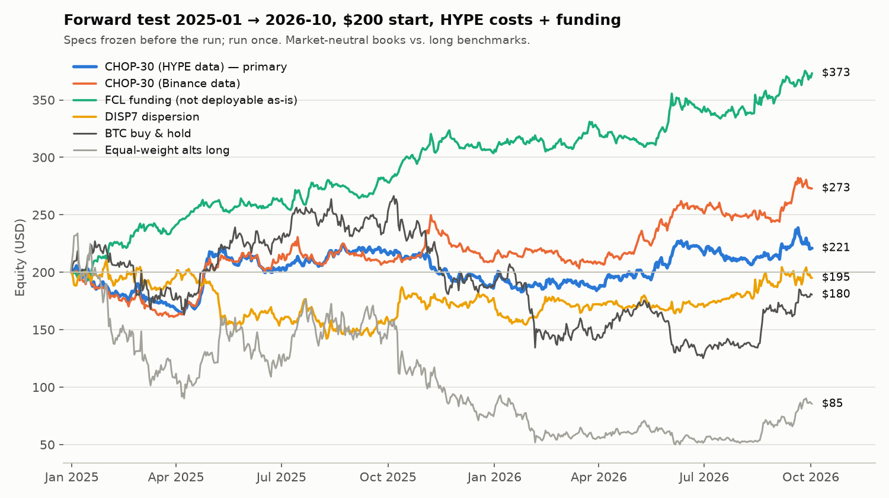
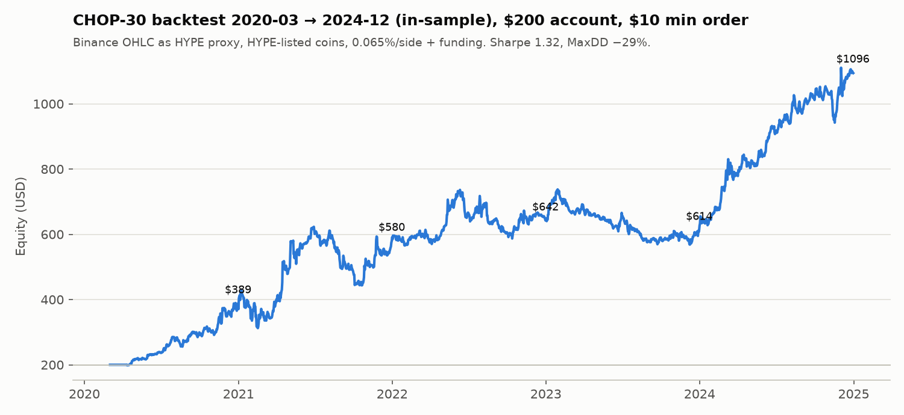
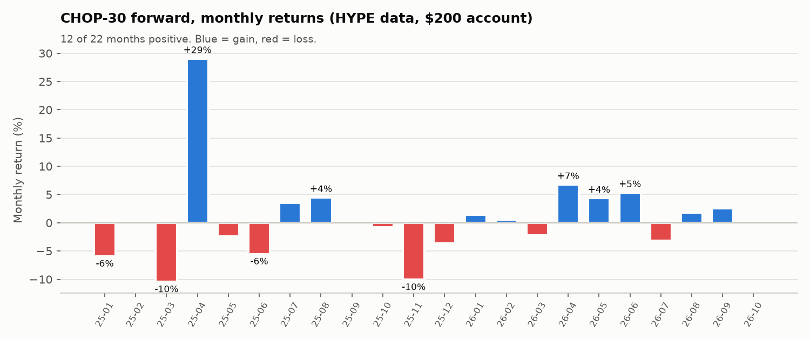

# Alpha Hunt 24 Okt 2026: CHOP-30 dan temuan lainnya

Permintaan: buat satu strategi trading crypto dengan alpha nyata, dikerjakan seperti quant profesional. Backtest pakai 2020–2024, forward test 2025 ke atas, modal awal 200 USD, dan jujur kalau alpha tidak ditemukan.

Syarat tambahan dari user selama proses:

1. Eksekusi di **HYPE (Hyperliquid DEX)**.
2. **Tanpa VPS**: semua harus jalan sebagai cron GitHub Actions, tanpa sinyal funding, OI, atau L/S. Binance kena geoblock, jadi sinyal live harus datang dari **candle HYPE saja**.

Semua kode dan hasil mentah ada di [alpha_20261024/](alpha_20261024/).

---

## TL;DR

> [!WARNING]
> **Disclaimer jujur.** Saya **tidak menemukan alpha yang terbukti** di antara strategi yang memenuhi semua syarat Anda (hanya candle HYPE, tanpa VPS).
>
> Kandidat terbaik, **CHOP-30**, lolos semua uji di 2020–2024 (Sharpe 1,32 di akun $200). Di forward test 2025-01 → 2026-10 hasilnya **$200 → $221 (+10,5%, Sharpe 0,38, t 0,44)**.
> - Itu tidak beda signifikan dari nol.
> - Kalau satu bulan terbaiknya (April 2025, +29%) dibuang, hasilnya **−14%**.
> - Menurut aturan yang ditulis **sebelum** forward test dibuka, statusnya **"inconclusive"**. Jangan dipakai live dulu; paper trade minimal 3–6 bulan.

| 2025-01 → 2026-10, modal $200, biaya HYPE + funding | Akhir | Return | Sharpe | MaxDD | Bisa jalan tanpa VPS? |
|---|---|---|---|---|---|
| **CHOP-30, data HYPE (strategi utama)** | **$221** | **+10,5%** | **0,38** | −20% | ✅ |
| CHOP-30, data candle Binance (pembanding) | $273 | +36,5% | 0,96 | −20% | – (Binance diblokir) |
| DISP7 dispersion timing (runner-up) | $195 | −2,4% | 0,10 | −32% | ✅ |
| **FCL funding-crowding** (dari ronde 1) | **$373** | **+86,6%** | **2,33** | **−6,6%** | ⚠️ bisa, lewat API HYPE (lihat §6) |
| BTC buy & hold | $180 | −9,8% | 0,08 | −53% | – |
| Basket alt equal-weight, long | $85 | −57,3% | −0,23 | −79% | – |

**Temuan paling berharga justru FCL** (short koin dengan funding 14 hari tertinggi, long yang terendah).
- IS Sharpe 1,6, forward Sharpe 2,3 (t 3,1). Ini satu-satunya alpha yang lolos semua tahap.
- Sinyalnya butuh funding **Binance**, jadi tidak memenuhi syarat Anda. Tapi API HYPE ternyata menyediakan funding Binance (`predictedFundings`, field `BinPerp`, 234 koin), jadi FCL bisa dijalankan **tanpa VPS dan tanpa akses Binance**.
- Keputusan ada di Anda; detailnya di §6.

---

## 1. Cara kerja (protokol)

| Komponen | Isi |
|---|---|
| Data | Data lake Binance USDT-M 2020→2026-10 (OHLCV, funding, OI, L/S, premium, spot) + candle & funding HYPE |
| Universe | 150 perp Binance yang masih hidup (ada survivorship bias, sudah disetujui) → dibatasi ke **92 koin yang listing di HYPE**, top-50 menurut likuiditas point-in-time |
| Split | **IS 2020-01 → 2024-12** untuk riset. **Forward 2025-01 → 2026-10-02** dikunci di kode: `lab.py` memotong data di 2025-01-01 kecuali `ALPHA_FORWARD=1`. Tidak ada agen riset yang menyalakan flag itu |
| Eksekusi | Sinyal dihitung saat close bar, trade di bar berikutnya. Tidak ada lookahead; dicek dengan uji pemotongan data (lihat §3) |
| Biaya | 0,065% per sisi (taker HYPE 0,045% + slippage 0,02%), ditambah **funding riil** dibayar/diterima. Stress test dengan 2× biaya dan telat 1 hari |
| Akun kecil | Replay akun $200 dengan **minimum order $10**: order di bawah $10 tidak terkirim, compounding pakai equity riil |
| Anti-overfit | Grid ditulis sebelum dijalankan (pre-registered), maksimal ±40 config per keluarga. Semua trial dihitung (±900 config) untuk deflated Sharpe. Setiap kandidat diverifikasi oleh agen lain yang tugasnya mencoba menjatuhkannya |
| Freeze | Spec, hash kode dan aturan lulus/gagal ditulis di [SPEC_CHOP30_v1.md](alpha_20261024/SPEC_CHOP30_v1.md) **sebelum** forward dibuka. Forward dijalankan **sekali**, untuk semua kandidat sekaligus |

Riset dikerjakan oleh 10 "quant researcher" paralel dalam 2 ronde, masing-masing mendapat 2 keluarga hipotesis. Setelah itu 8 verifier independen. Ronde 2 diulang khusus dengan input OHLCV saja, setelah Anda menyebut syarat tanpa VPS.

## 2. Corong riset: 22 keluarga hipotesis, 3 yang selamat

| # | Hipotesis | Hasil IS (2020–2024) | Status |
|---|---|---|---|
| 1 | **Funding-crowding cross-sectional (FCL)** | Sharpe 1,61; tiap tahun positif; 2× biaya 1,40 | ✅ lolos verifikasi. **Forward 2,33**, tapi pakai funding Binance |
| 2 | Cash-and-carry spot/perp BTC+ETH | 12%/thn, tapi 2022 hanya +2% | premi pasar, bukan alpha |
| 3 | Timing jam settlement funding | efek < 10 bp, lebih kecil dari biaya | ❌ |
| 4 | Posisi top trader vs retail (L/S ratio) | Sharpe 1,3–1,5, tapi sampel cuma 2023–24 | ❌ data tidak bisa diambil live |
| 5 | Dinamika OI (ΔOI, leverage ratio) | ≤ 0,8, gagal di 2× biaya | ❌ |
| 6 | Basis spot vs perp 7 hari | 1,21–1,35 | butuh harga futures Binance live |
| 7 | Taker flow / lonjakan volume | ternyata momentum terselubung (korelasi 0,57) | ❌ |
| 8 | Short-term reversal 1–5 hari dan 4 jam | net −1 sampai −5 (yang terjadi malah continuation) | ❌ |
| 9 | Low-beta / IVOL / MAX / skew | arah buku teks gagal di 28/28 config | ❌ |
| 10 | Seasonality jam/hari | tidak persisten | ❌ |
| 11 | BTC → alt lead-lag | tanda berlawanan, semua aturan rugi | ❌ |
| 12 | Vol-managed basket | tidak lebih baik dari buy & hold | ❌ |
| 13 | Seasonality cross-sectional slot 4 jam | **gross nyata (alpha t 6,6)**, tapi break-even 2,6 bp/sisi | ❌ hanya bisa dengan maker + VPS |
| 14 | Turn-of-month / akhir bulan | 0 dari 24 lolos validasi 2023–24 | ❌ |
| 15 | 52-week-high / anchoring | 0,6–1,16, ternyata momentum | ❌ |
| 16 | Residual momentum, frog-in-the-pan | ≤ 0,71, 2022 negatif | ❌ |
| 17 | Bentuk candle (CLV, wick) | momentum terselubung | ❌ |
| 18 | Ukuran trade rata-rata / FOMO retail | hipotesis ditolak | ❌ |
| 19 | Downside beta / coskewness | BAB terselubung | ❌ |
| 20 | **Struktur volatilitas → CHOP-30** | Sharpe 1,34; 2× biaya 1,09; lag 1 0,92 | ✅ dipilih. **Forward 0,38** |
| 21 | Umur listing (unlock/supply overhang) | rusak oleh survivorship | ❌ |
| 22 | **Dispersion timing alt vs BTC (DISP7)** | 1,38; plateau stabil | ✅ runner-up. **Forward 0,10 / −0,77** |

Pelajaran besarnya mirip dengan [REPORT_EDGE.md](REPORT_EDGE.md): **edge yang kuat di crypto datang dari data leverage (funding/OI), bukan dari pola harga.** Dari 12 ide yang hanya memakai harga di ronde 2, tidak ada yang kuat.

## 3. Strategi utama: CHOP-30

### Aturan (spec beku v1, [SPEC_CHOP30_v1.md](alpha_20261024/SPEC_CHOP30_v1.md))

| Item | Aturan |
|---|---|
| Waktu | Sekali sehari setelah candle harian HYPE close (00:00 UTC = **07:00 WIB**), GitHub Actions jalan 00:05–01:00 UTC |
| Universe | 92 koin HYPE yang sudah trading di HYPE ≥ 60 hari, top 50 menurut median volume USD 30 hari |
| Sinyal | `ratio = √( rata2_30hari[(ln H/L)² / (4·ln2)] ÷ rata2_30hari[(ln Cₜ/Cₜ₋₁)²] )`, yaitu volatilitas range (Parkinson) dibagi volatilitas close-to-close |
| Arti | **ratio tinggi** = range harian besar tapi close tidak ke mana-mana ("choppy", banyak wick, rebutan leverage). **Ratio rendah** = close bergerak sebesar range-nya (bersih, berarah) |
| Posisi | **Long k koin dengan ratio terendah, short k koin dengan ratio tertinggi**, equal weight, +50% / −50% ekuitas (dollar-neutral, gross 1×) |
| k | `min(floor(ekuitas/25), floor(20% × N), floor(N/4))`. Di $200, k = 8, jadi 16 posisi × $12,50. Kalau k < 3, flat |
| Order | Koin yang keluar dari buku ditutup penuh. Koin lain hanya di-trade kalau selisihnya ≥ $10. Rebalance harian. **Jangan pernah trade dengan sinyal yang lebih tua dari 1 hari** (telat 2 hari, Sharpe IS turun ke 0,22) |
| Margin | Cross margin di subaccount khusus, leverage efektif ±1× |

### Hasil IS 2020-03 → 2024-12 (candle Binance sebagai proxy HYPE)

| Versi | Hasil | Sharpe | MaxDD |
|---|---|---|---|
| Buku ideal (fraksional) | – | 1,37 | −27% |
| **Akun $200, min order $10** | **$200 → $1.094** | **1,32** | −29% |
| Mulai baru $200 di 2023-01 | → $350 | 1,39 | −24% |

Return per tahun akun $200: 2020 +94%, 2021 +49%, 2022 +11%, 2023 −5%, 2024 +78%.

Hasil stress test IS:

| Uji | Sharpe |
|---|---|
| 2× biaya | 1,10 |
| Telat 1 hari | 1,00 |
| Plateau 20 sel parameter (median) | 1,20; semua sel positif di tiap sub-periode |

### Verifikasi (2 agen independen, IS saja)

- ✅ Re-implementasi dari teks aturan saja menghasilkan angka yang identik. Uji pemotongan data di 3 tanggal: sinyal dan return sebelum tanggal potong identik bit-per-bit. **Tidak ada lookahead.**
- ⚠️ **Deflated Sharpe ≈ 0,26–0,28** setelah memperhitungkan ±900 config yang dicoba satu desk. Secara statistik, hasil IS ini **tidak bisa dibedakan dari "yang terbaik dari 900 percobaan acak"**.
- ⚠️ Survivorship: koin muda menyumbang 44% profit harga. Leg long sebagian membeli koin yang crash lalu memantul, padahal koin yang mati (LUNA, FTT) tidak ada di data.
- ⚠️ Cara menghitung "20% teratas/terbawah" (selisih 1 koin per sisi) menggeser Sharpe ±0,3.
- Perkiraan verifier untuk peluang forward Sharpe > 0,5: **38–40%**.

## 4. Forward test 2025-01-01 → 2026-10-02 (sekali jalan)

| CHOP-30 | Data HYPE (utama) | Data Binance | Ideal (HYPE) |
|---|---|---|---|
| $200 → | **$220,94** | $272,98 | $251,62 |
| Return / CAGR | +10,5% / 5,9% | +36,5% / 19,4% | +25,8% / 14,0% |
| Sharpe (t-stat) | **0,38 (0,44)** | 0,96 (1,11) | 0,80 (0,99) |
| MaxDD | −20,3% | −19,9% | −16,1% |
| Bulan positif | 12 dari 22 | 10 dari 22 | 13 dari 22 |
| Bulan terburuk | −10,5% | −11,7% | −7,6% |
| Rata-rata posisi | 15 | 16 | 20 |
| Fee / funding | **−$26,2** / +$1,5 | −$25,2 / +$4,1 | −$28,8 / +$1,5 |
| Jumlah order | 2.994 (±4,7/hari, $10–25 per order) | 2.840 | – |

Cara membaca hasil di atas:

1. **Profitnya tergantung satu episode.** April 2025 menyumbang +29% (crash tarif lalu rebound). Tanpa bulan itu: **−14,4%**. 2025 secara keseluruhan −6,9%, 2026 YTD +18,7%.
2. **Fee lebih besar dari profit bersih.** Fee $26 vs profit $21, jadi profit kotornya ±$47. Turnover ±106×/tahun memakan ±7% modal per tahun.
3. **Tetap market-neutral.** Saat alt equal-weight −57% dan BTC −10%, CHOP-30 positif dengan DD hanya −20%. Long leg naik +20,6% gross, padahal pasar alt anjlok.
4. **Hasil sangat sensitif terhadap sumber candle.** Ini diagnosis setelah forward dibuka, hanya untuk penjelasan; spec **tidak** diubah:

| Sinyal dari | Universe | Eksekusi | Sharpe forward |
|---|---|---|---|
| candle Binance | Binance | Binance | 0,96 |
| candle Binance | Binance | **HYPE** | 0,97 |
| candle Binance | HYPE | HYPE | 0,91 |
| **candle HYPE** | HYPE | HYPE | **0,38** |

Venue eksekusi dan universe tidak berpengaruh. Yang merusak adalah **wick khas HYPE** di data high/low. Ranking sinyal kedua venue berkorelasi 0,97, tapi 8 koin paling ekstrem di tiap sisi sering berbeda. Bot live hanya bisa membaca candle HYPE, jadi angka 0,38 yang relevan.

### Verdict CHOP-30 (aturan dibekukan sebelum forward)

> Sharpe ≥ 0,5 dan DD lebih baik dari −35% → "edge bertahan". 0 < Sharpe < 0,5 → **"inconclusive"** ← **ini hasilnya**. Sharpe ≤ 0 → "gagal".

**Kesimpulan: CHOP-30 belum terbukti sebagai alpha.** Strategi ini tidak rugi dan tetap netral pasar di periode yang berat, tapi bukti statistiknya lemah (t 0,44) dan profitnya bergantung pada satu bulan.

## 5. Runner-up yang gagal: DISP7

Aturan: saat dispersi return 7 hari antar-koin tinggi (persentil > 2/3 dalam 365 hari), long basket alt / short BTC. Saat rendah (< 1/3), sebaliknya.

- IS: Sharpe 1,38, plateau stabil.
- Forward: **−2,4% di data HYPE, −38% di data Binance**.
- Verifier sudah memperingatkan bahwa 69% profit IS datang dari 3 episode (terutama alt season 2021, yang juga digelembungkan survivorship). **Tidak disarankan.**

## 6. Saran strategi yang layak dicoba

### ⭐ 1. FCL: Funding-Crowding Long/Short (alpha terkuat yang ditemukan)

**Aturan v1.0** (kode [fcl.py](alpha_20261024/fcl.py)):

| Item | Aturan |
|---|---|
| Universe | Harian, koin HYPE top-50 |
| Sinyal | F14 = jumlah funding **Binance** 14 hari |
| Short | k koin dengan F14 tertinggi, kecuali koin yang momentum 14 harinya di 10% teratas (anti-squeeze) |
| Long | k koin dengan F14 terendah |
| Gross / k | 1×, k = 8 per sisi di $200 |
| Stop | Stop darurat short di +40% |

Logikanya: funding yang tinggi terus-menerus berarti long ber-leverage sedang ramai. Pihak short dibayar carry, dan harganya cenderung turun saat keramaian itu bubar. Edge-nya ada di **sisi short**.

| | IS 2020–24 | Forward 2025-01 → 2026-10 |
|---|---|---|
| Akun $200 | → $868 (Sharpe 1,64, DD −27%) | **→ $373 (+86,6%), Sharpe 2,33, DD −6,6%, 17 dari 22 bulan positif** |
| Lolos uji | re-implementasi identik, tanpa lookahead, CI bootstrap 0,81–2,35 | konsisten di data HYPE dan Binance ($373 / $382) |

**Kenapa tidak dijadikan strategi utama:**
- Sinyalnya funding, dan Anda minta tanpa funding / tanpa VPS.
- Funding **HYPE** sendiri gagal dipakai sebagai sinyal (Sharpe −0,8 di 2023–24).

**Jalur tanpa VPS (sudah dicek 2026-10-24):**
- Endpoint publik `POST api.hyperliquid.xyz/info {"type":"predictedFundings"}` mengembalikan funding **Binance** (`BinPerp`, plus `fundingIntervalHours`) untuk 234 koin. Endpoint ini bisa diakses dari jaringan Anda dan dari GitHub Actions.
- Cron GitHub Actions (watcher 10 menit seperti bot RNT/MEX) mencatat rate terakhir sebelum tiap settlement ke CSV state di repo. F14 dihitung dari catatan itu.
- Warm-up 14 hari, atau bootstrap dari data lake sampai 2026-09-30.

**Risiko:**
- Rate *predicted* sedikit berbeda dari rate *settled*.
- Cron bisa melewatkan snapshot.
- Periode forward sangat menguntungkan strategi ini (alt −57%), jadi harapkan Sharpe ±1–1,5, bukan 2,3.
- Deflated Sharpe di IS hanya 0,3–0,6.

**Saran: paper trade FCL berdampingan dengan CHOP-30.** Kalau Anda setuju memakai sinyal funding lewat API HYPE, FCL kandidat yang jauh lebih kuat.

### 2. CHOP-30, paper trade dulu
- Kalau mau dicoba: paper 3–6 bulan dulu. Stop kalau DD > 30% atau Sharpe rolling 180 hari < 0.
- Ide yang **belum diuji**: order maker post-only (fee 0,015% vs 0,045%) bisa memangkas drag biaya ±5%/thn, karena saat ini biaya > profit.

### 3. Yang tidak disarankan
- DISP7 (gagal forward).
- Seasonality slot 4 jam (alpha gross nyata, tapi hanya bisa dipanen dengan order maker yang terus dikelola, jadi butuh VPS).
- Semua ide reversal dan low-volatility (gagal di IS).

### 4. Perbaikan data yang paling berharga
Tambahkan **perp yang sudah delisted** (arsip lengkap data.binance.vision). Survivorship bias membuat semua sinyal yang long alt terlihat lebih bagus dari kenyataan, termasuk leg long CHOP-30 dan DISP7.

## 7. Batasan yang harus diingat

- **Survivorship bias:** hanya koin yang masih hidup per Sep 2026 (disetujui user). Ini menggelembungkan sisi long.
- **Data HYPE sebelum listing** berisi harga oracle hasil backfill dengan volume 0. Versi HYPE-native mewajibkan volume > 0 selama ≥ 60 hari.
- **Biaya:** taker + 0,02% slippage. Order $10–25 di koin mid-cap HYPE mungkin kena slippage lebih besar saat volatil.
- **Forward 21 bulan = sampel pendek.** Satu episode (April 2025) bisa membalik kesimpulan.
- ±900 config dicoba satu desk. Semua angka IS di laporan ini sebaiknya dipotong ±50% sebagai ekspektasi.
- Saya bukan penasihat keuangan berlisensi. Ini riset, bukan rekomendasi investasi.

## 8. File

| Path | Isi |
|---|---|
| [alpha_20261024/lab.py](alpha_20261024/lab.py) | Harness: loader panel, guard split, backtest + biaya + funding, metrik, deflated Sharpe |
| [alpha_20261024/HUNT_BRIEF.md](alpha_20261024/HUNT_BRIEF.md) | Aturan riset untuk semua agen (termasuk syarat HYPE dan tanpa VPS) |
| `alpha_20261024/hunt/*/RESULTS.md` | Laporan 10 hunter (22 keluarga hipotesis) |
| `alpha_20261024/verify*/` | Bukti verifikasi (re-implementasi, audit lookahead, overfit, risiko) |
| [alpha_20261024/SPEC_CHOP30_v1.md](alpha_20261024/SPEC_CHOP30_v1.md) | Spec beku + kriteria forward (ditulis sebelum forward dibuka) |
| [alpha_20261024/final/strategies.py](alpha_20261024/final/strategies.py) | Implementasi CHOP-30 dan DISP7 + replay akun $200 |
| [alpha_20261024/final/forward.py](alpha_20261024/final/forward.py) | Forward test sekali jalan; hasil di `final/forward_results.json` |

Reproduksi forward: `python alpha_20261024/final/forward.py` (±5 menit).
